<p align="center">
  
</p>

<h1 align="center">Rulemap</h1>

<p align="center">
  <strong>Your coding agent has rules. Do you know which ones actually apply?</strong>
</p>

<p align="center">
  <a href="https://github.com/mansoor-mamnoon/rulemap/actions/workflows/ci.yml"></a>&nbsp;
  <a href="https://github.com/mansoor-mamnoon/rulemap/blob/main/LICENSE"></a>&nbsp;
  <a href="https://www.npmjs.com/package/rulemap"></a>
</p>

<p align="center">
  <a href="https://mansoor-mamnoon.github.io/rulemap/">Live demo</a>&nbsp;&nbsp;·&nbsp;&nbsp;
  <a href="#try-it">Try it</a>&nbsp;&nbsp;·&nbsp;&nbsp;
  <a href="#why-this-exists">Why?</a>&nbsp;&nbsp;·&nbsp;&nbsp;
  <a href="#supported-agents">Agents</a>&nbsp;&nbsp;·&nbsp;&nbsp;
  <a href="#web-viewer">Web viewer</a>
</p>

<br>

<p align="center">
  
</p>

<br>

## Try it

```bash
npx rulemap inspect . --file src/auth.ts --web
```

One command. No API key, no account, no telemetry. Everything runs locally.

## Why this exists

You write an `AGENTS.md` with testing rules. You add `.claude/rules/security.md` for path-scoped validation. You drop `.cursor/rules/release.mdc` for changelog checks.

Then your agent ignores half of them.

Each coding agent discovers instructions differently. Codex walks the directory tree with override priority. Claude Code checks frontmatter globs and expands `@import` chains. Cursor reads `.mdc` files with `alwaysApply` and description-based routing. Copilot looks for `applyTo` fields in `.github/instructions/`.

The rules are documented, but they're scattered across four different docs. Nobody reads all four before wondering why their agent skipped a rule.

**Rulemap shows you exactly which instructions apply to a given file, for a given agent, and tells you why each one is included, excluded, or conditional.**

## What you get

For every instruction file in your repo:

| | |
|---|---|
| **Status** | Included, excluded, or conditional — with the exact reason |
| **Load order** | The sequence your agent reads them in |
| **Byte size** | Relevant for Codex's 32 KB instruction budget |
| **Import chain** | Tracks Claude Code's `@import` expansion |
| **Frontmatter warnings** | Catches bad globs, missing fields, invalid YAML |

## Supported agents

| Profile | What it models |
|---------|----------------|
| **Codex** | `AGENTS.md` / `AGENTS.override.md` discovery, directory chain, byte budget |
| **Claude Code** | `CLAUDE.md`, `.claude/rules/` with path scoping, `@import` expansion, `AGENTS.md` fallback |
| **Cursor** | `.cursor/rules/*.mdc` with `alwaysApply`, `globs`, `description` routing, plus `AGENTS.md` |
| **Copilot** | `.github/copilot-instructions.md`, `.github/instructions/*.instructions.md` with `applyTo` |

Profiles are based on each agent's public documentation as of October 2026. They model documented repository rules, not observed model behavior.

## CLI

```bash
# Inspect instructions for a specific file
npx rulemap inspect . --file src/auth.ts

# Open the interactive web viewer
npx rulemap inspect . --file src/auth.ts --web

# Compare what two agents see from the same repo
npx rulemap compare . --file src/auth.ts --profiles codex,claude

# Run a built-in demo scenario
npx rulemap demo --web

# List all agent profiles
npx rulemap profiles
```

### Options

| Flag | Default | Description |
|------|---------|-------------|
| `--profile <name>` | `codex` | Agent profile to use |
| `--format <fmt>` | `text` | Output: `text`, `json`, `markdown`, `html` |
| `--web` | — | Open an interactive local viewer |
| `--output <path>` | — | Save the report to a file |
| `--include-content` | `false` | Include instruction text in exports |
| `--profiles <a,b>` | `codex,claude` | Profiles for `compare` |
| `--cwd <path>` | `.` | Agent launch directory (affects Codex discovery) |
| `--max-bytes <n>` | `32768` | Codex instruction byte budget |
| `--fail-on-warnings` | — | Exit code 2 on scan warnings |

### JSON output

```bash
rulemap inspect . --file src/auth.ts --format json | jq '.rules[] | select(.status == "included") | .path'
```

The JSON schema is stable at `schemaVersion: 1`. Every rule includes `path`, `status`, `reason`, `bytes`, `startLine`, `endLine`, and optional `order` and `importedFrom`.

## Web viewer

```bash
npx rulemap inspect . --file src/auth.ts --web
```

Opens a local-only viewer at `127.0.0.1` with:
- Interactive instruction map with real-time editing
- Agent comparison view (same repo, different rules)
- File browser with status indicators
- Built-in demo scenarios
- JSON export (content redacted by default)
- Folder import from the browser (files stay on your device)

Also available at [mansoor-mamnoon.github.io/rulemap](https://mansoor-mamnoon.github.io/rulemap/) with demo repositories.

## Built-in demos

```bash
npx rulemap demo --web                    # The hidden override
npx rulemap demo --example glob-mismatch  # The glob that misses
npx rulemap demo --example agent-switch   # Same repo, different context
```

| Scenario | What it shows |
|----------|---------------|
| **The hidden override** | An `AGENTS.override.md` silently replaces your testing instructions |
| **The glob that misses** | A `src/*.ts` glob doesn't reach `src/api/auth.ts` |
| **Same repo, different context** | Four agents see completely different rules from the same files |

## Programmatic API

```typescript
import { inspect } from 'rulemap';
import type { Inspection, RepoFile } from 'rulemap';

const files: RepoFile[] = [
  { path: 'AGENTS.md', content: '# Rules\nRun tests before finishing.' },
  { path: 'src/auth.ts', content: 'export const auth = true;' },
];

const result: Inspection = inspect(files, {
  file: 'src/auth.ts',
  profile: 'codex',
});

for (const rule of result.rules) {
  console.log(`${rule.status}: ${rule.path} — ${rule.reason}`);
}
```

## Privacy

- No API keys, accounts, or telemetry
- No network requests (the CLI never calls home)
- The local viewer binds to `127.0.0.1` with a random token
- Content is redacted from exports by default
- Symlinks outside the repository are refused
- The browser demo reads your folder in-page; files never leave your device

## Contributing

Issues and PRs are welcome. If you're adding a new agent profile, include:
1. A link to the agent's public documentation
2. The documented discovery rules
3. At least one demo scenario that highlights a non-obvious behavior
4. Tests covering the resolution logic

## License

MIT
